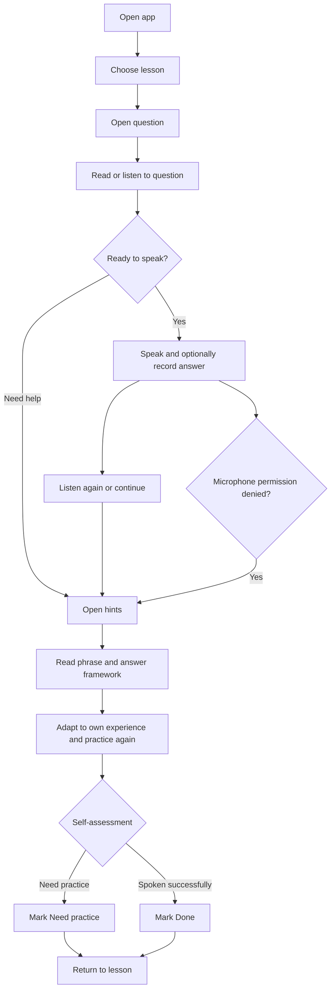
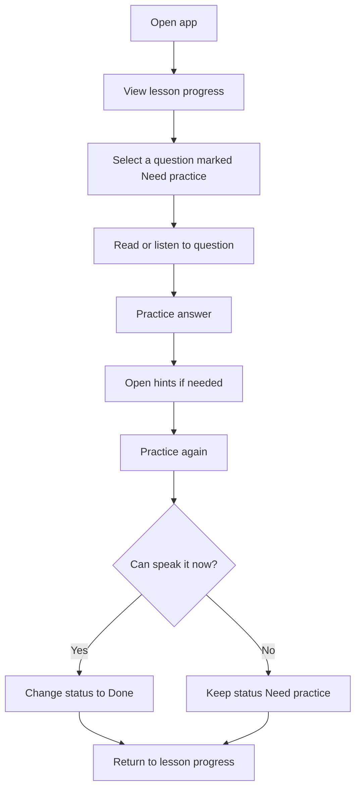

# Assignment 1 — Product Discovery & Foundation

## Interview English — Luyện phỏng vấn Software Intern

**Môn học:** CO3043 — Mobile Application Development  
**Cập nhật:** 14/10/2026  
**GitHub Organization:** https://github.com/mobile-app-CO3043  
**Repository:** https://github.com/mobile-app-CO3043/interview-english

> Phạm vi bằng chứng: Báo cáo sử dụng dữ liệu khảo sát hiện có và nêu rõ các giới hạn. Những kết luận chưa đủ bằng chứng được giữ ở trạng thái `Investigate further` hoặc `Keep provisionally`, thay vì trình bày như đã được xác nhận.

---

## 1. Project Direction

### Problem

Sinh viên CNTT năm cuối hoặc mới tốt nghiệp đang chuẩn bị ứng tuyển vị trí **Software Intern** có thể biết kỹ năng, dự án và kinh nghiệm của mình, nhưng gặp khó khăn khi chuyển các ý đó thành câu trả lời tiếng Anh rõ ràng trong lúc luyện tập hoặc phỏng vấn.

Các cách chuẩn bị hiện tại thường là đọc bài viết/tài liệu, xem video, dùng công cụ AI hoặc tự viết câu trả lời. Những cách này có thể cung cấp nội dung, nhưng chưa chắc tạo ra một luồng luyện nói ngắn, có bối cảnh Software Intern, cho phép người học tự nói, xem gợi ý phù hợp với trải nghiệm của mình và luyện lại.

### Target users

Người dùng mục tiêu hiện tại là:

- Sinh viên năm cuối ngành CNTT hoặc ngành liên quan; hoặc mới tốt nghiệp trong vòng 12 tháng.
- Có kế hoạch ứng tuyển Software Intern trong ba tháng tới.
- Dự kiến sử dụng tiếng Anh trong phỏng vấn.
- Có một khoảng không gian riêng phù hợp để nói thành tiếng khi luyện tập.

### Context and current behaviour

Người dùng chuẩn bị cho một cuộc phỏng vấn gần hạn, thường ở nhà hoặc trong phòng riêng. Họ có thể tìm tài liệu trên Internet, xem video, dùng AI hoặc tự viết câu trả lời. Khảo sát ban đầu cho thấy đọc bài viết/tài liệu là cách được chọn nhiều nhất trong nhóm phù hợp (6/9).

### Proposed direction

**Interview English** là ứng dụng hỗ trợ các phiên luyện ngắn 3–5 phút. Trong một lượt học, người dùng:

1. Chọn bài học hoặc câu hỏi phỏng vấn Software Intern.
2. Nghe/đọc câu hỏi và tự trả lời trước.
3. Xem cụm từ, khung trả lời và giải thích tiếng Việt.
4. Luyện lại dựa trên trải nghiệm thật của mình.
5. Tự đánh dấu câu đã nói được hoặc cần luyện thêm.

MVP không hứa hẹn AI chấm phát âm hay tự động đánh giá chất lượng nội dung.

### Change log

Chưa có thay đổi lớn về vấn đề cốt lõi. Tuy nhiên, bằng chứng hiện tại không ủng hộ mô tả rằng người dùng có thể luyện nói “mọi lúc, mọi nơi”. Hướng sản phẩm được thu hẹp thành luyện ngắn trong không gian riêng và cần được kiểm tra thêm về mức phù hợp của mobile.

---

## 2. Mobile Product Rationale

### Why mobile may improve the task

- Một phiên luyện 3–5 phút có thể phù hợp với các tương tác ngắn trước khi phỏng vấn hoặc trong thời gian tự học.
- Điện thoại có micro và loa/tai nghe sẵn có để người học nghe câu hỏi, tự ghi âm và nghe lại.
- Tiến độ có thể được lưu cục bộ trên thiết bị, không cần người dùng mở máy tính chỉ để xem lại câu cần ôn.
- Thiết bị cá nhân giúp người dùng giữ bản ghi luyện tập ở trên máy thay vì chia sẻ cho người khác.

### Constraints and alternative platforms

- Luyện nói thành tiếng cần không gian phù hợp; trong mẫu phù hợp, 4/9 người nói rằng họ phù hợp nhất khi ở nhà hoặc trong phòng riêng.
- 4/9 người nói rằng dù có nhu cầu luyện, họ ưu tiên máy tính hơn điện thoại.
- Máy tính có thể phù hợp hơn cho việc viết, đọc tài liệu dài hoặc chuẩn bị kỹ nội dung trước phỏng vấn.

### Current decision

**Investigate further.** Mobile có thể hỗ trợ tốt lượt luyện ngắn có micro/ghi âm, nhưng khảo sát chưa đủ để kết luận điện thoại tốt hơn máy tính cho toàn bộ tác vụ chuẩn bị phỏng vấn. Nhóm sẽ kiểm tra điều này qua task test trên điện thoại trước khi coi rationale này là đã được xác nhận.

Mobile không được chọn chỉ vì đây là môn Mobile Application Development.

---

## 3. Critical Assumptions

| ID | Assumption | Why it matters | Current status |
|---|---|---|---|
| A1 | Người dùng mục tiêu gặp khó khăn diễn đạt tiếng Anh đủ thường xuyên để cần luyện lặp lại. | Nếu vấn đề ít xảy ra hoặc không ưu tiên, sản phẩm không có nhu cầu rõ ràng. | Investigate further |
| A2 | Luồng tự nói → xem gợi ý → luyện lại có giá trị hơn chỉ đọc nội dung. | Đây là core value path của MVP. | Keep provisionally |
| A3 | Phiên luyện nói 3–5 phút trên điện thoại phù hợp với hoàn cảnh thực tế. | Quyết định tính phù hợp của nền tảng mobile. | Investigate further / Revise |
| A4 | Gợi ý theo ngữ cảnh Software Intern và giải thích tiếng Việt giúp người dùng cá nhân hóa câu trả lời. | Quyết định phạm vi nội dung và cách trình bày gợi ý. | Keep provisionally |
| A5 | Tự đánh dấu “Đã nói được/Cần luyện lại” đủ hữu ích ở MVP đầu tiên. | Nếu không, phần theo dõi tiến độ cần được thay đổi hoặc giảm phạm vi. | Investigate further |

### Selected critical assumption

**A1:** Sinh viên CNTT thuộc target user thực sự thường gặp khó khăn khi biến ý kỹ thuật hoặc trải nghiệm dự án thành câu trả lời tiếng Anh trong lúc chuẩn bị/phỏng vấn Software Intern; các cách chuẩn bị hiện tại chưa đáp ứng đầy đủ nhu cầu luyện nói theo bối cảnh này.

---

## 4. Evidence Plan

### What we need to learn

- Vấn đề có xảy ra trong hành vi gần đây hay chỉ là cảm nhận chung?
- Người dùng hiện chuẩn bị bằng cách nào và thiếu điều gì?
- Người dùng có thể hoàn thành luồng tự nói → gợi ý → luyện lại không?
- Họ thực sự sẽ dùng điện thoại hay máy tính, trong bối cảnh nào?

### Research question

Với sinh viên CNTT sắp ứng tuyển Software Intern bằng tiếng Anh, việc luyện nói theo câu hỏi có ngữ cảnh và gợi ý cụm từ có giải quyết một khoảng trống thực tế so với cách chuẩn bị hiện tại không; và điện thoại có phù hợp cho lượt luyện 3–5 phút không?

### Evidence collected

- Khảo sát trực tuyến gồm 23 phản hồi từ 05/10/2026 đến 12/10/2026.
- Sau sàng lọc theo target user hẹp, mẫu phân tích là 9 phản hồi.

### Remaining uncertainty

Khảo sát chỉ đo tự báo cáo và ý định dùng. Nó không chứng minh người dùng thao tác được trên sản phẩm thật, sử dụng lặp lại hay cải thiện khả năng phỏng vấn.

### Next method: moderated task test and interview

| Item | Plan |
|---|---|
| Method | 5–6 buổi task test có quan sát, kết hợp phỏng vấn ngắn 15–20 phút. |
| Participants | Người đạt đủ ba điều kiện sàng lọc của target user. Không dùng người đã bị loại ở screening. |
| Task | Chọn một câu hỏi, tự nói câu trả lời, mở gợi ý, cá nhân hóa câu trả lời, luyện lại và đánh dấu cần ôn. |
| Evidence that supports A1/A2 | Người tham gia kể được tình huống gần đây, hoàn thành luồng mà không cần giải thích nhiều, và thấy luồng giải quyết khó khăn thực tế hơn cách hiện tại. |
| Evidence that challenges A1/A2 | Họ ít khi cần luyện, chỉ cần đọc tài liệu, hoặc không thấy gợi ý/luyện lại tạo thêm giá trị. |
| Evidence for mobile | Người tham gia chọn và dùng điện thoại trong một bối cảnh thực tế phù hợp. |
| Evidence against mobile | Họ nhất quán ưu tiên máy tính hoặc không có nơi phù hợp để nói trên điện thoại. |
| Unresolved result | Phản hồi chia đều, không có bối cảnh sử dụng rõ hoặc không thể hoàn thành task do prototype chưa đủ. |

---

## 5. User Research

### Method and participant selection

Nhóm sử dụng Google Forms để thu thập phản hồi. File xuất có 23 dòng phản hồi, tất cả có dấu thời gian. Form không thu dữ liệu định danh.

Target user được xác định bằng ba điều kiện: sinh viên năm cuối CNTT/ngành liên quan hoặc mới tốt nghiệp trong 12 tháng; có kế hoạch ứng tuyển Software Intern trong ba tháng; và dự kiến dùng tiếng Anh khi phỏng vấn. File hiện không có người mới tốt nghiệp phù hợp; 9 sinh viên năm cuối thỏa cả ba điều kiện được dùng làm mẫu phân tích.

### Giới hạn của bằng chứng tuyển người và nghiên cứu

File xuất khảo sát không ghi nhận kênh tuyển người tham gia hoặc tiêu chí chọn người
ngoài các câu hỏi sàng lọc. Vì vậy, dữ liệu hiện tại được xem là mẫu nghiên cứu khám
phá, không phải mẫu đại diện có thể dùng để suy rộng cho toàn bộ sinh viên CNTT.

Báo cáo này không tuyên bố đã có bằng chứng từ task test có điều phối hoặc phỏng vấn
sâu. Các phát hiện hiện dựa trên hành vi tự báo cáo và ý định của người trả lời,
chưa phải hành vi quan sát khi dùng prototype. Do đó, các assumption về việc sử dụng
lặp lại, mức phù hợp của mobile và giá trị của speaking loop vẫn được giữ ở trạng
thái `Investigate further` hoặc `Keep provisionally`, thay vì được trình bày như đã
được xác nhận.

### Data quality and handling

- 23/23 phản hồi có dữ liệu ở câu 1–10; câu hỏi mở cuối có 17/23 phản hồi trống.
- Không có hai bộ câu trả lời hoàn toàn giống nhau, nhưng do không thu định danh, không thể khẳng định tuyệt đối mỗi dòng là một người khác nhau.
- Nhóm gộp hai cách ghi tương đương ở câu ngành học: “CNTT” và “công nghệ thông tin”.
- Người không đạt sàng lọc vẫn có câu trả lời ở các câu chính. Điều này cho thấy phân nhánh form có thể chưa được cấu hình hoặc chưa hoạt động đúng. Các số liệu chính vì vậy chỉ dùng mẫu `n = 9`.

### Findings from target-user responses (n = 9)

| Finding | Evidence | Interpretation |
|---|---|---|
| Vấn đề chưa được chứng minh là thường xuyên | 5/9 chưa luyện/phỏng vấn tiếng Anh trong 30 ngày; 2/9 đã luyện nhưng không gặp khó khăn; 2/9 báo cáo 1–5 buổi biết ý nhưng khó diễn đạt. | Không thể khẳng định A1 đã được xác nhận. |
| Cách chuẩn bị hiện tại thiên về đọc | 6/9 chọn đọc bài viết/tài liệu Internet là cách dùng nhiều nhất. | Có cơ hội kiểm tra liệu việc chuyển từ đọc sang nói có tạo giá trị hay không. |
| Thiếu phản hồi và ngữ cảnh là các tín hiệu nhu cầu | 3/9 không biết câu trả lời cần cải thiện ở đâu; 2/9 nói nội dung ít liên quan Software Intern. | Gợi ý theo bối cảnh có thể hữu ích, nhưng cần task test. |
| Core learning loop có tín hiệu ban đầu | 5/9 chọn tự nói → gợi ý → luyện lại là giá trị nhất; 3/9 chọn cụm từ/khung trả lời. | Giữ hai phần này trong MVP một cách tạm thời. |
| Mobile context bị chia đôi | 4/9 chọn ở nhà/phòng riêng; 4/9 ưu tiên máy tính hơn điện thoại. | Không được quảng bá là “luyện mọi lúc, mọi nơi”. |
| Luồng chưa hoàn toàn tự giải thích | 5/9 hiểu luồng; 2/9 chưa rõ bước tự nói trước gợi ý; 2/9 chưa rõ cách cá nhân hóa gợi ý. | Cần hướng dẫn ngắn trong lượt học đầu tiên. |

### Research limitations

- Mẫu nhỏ, không được chọn ngẫu nhiên và chưa đại diện cho toàn bộ sinh viên CNTT.
- Nhiều người trả lời không thuộc target user hẹp.
- Phản hồi về tính năng và mobile là ý định sau khi đọc mô tả, không phải hành vi quan sát trên app.
- Không có phỏng vấn sâu, quan sát ngữ cảnh hoặc đo lường kết quả học.

---

## 6. Existing Solutions and Alternatives

| Alternative | What it already does | What we learn | Opportunity / boundary for Interview English |
|---|---|---|---|
| [ELSA Speak](https://elsaspeak.com/en) | Luyện nói tiếng Anh, role-play và phản hồi phát âm/cá nhân hóa bằng AI. | Phản hồi nhanh và bài học ngắn là giá trị người học đã có thể kỳ vọng. | MVP không cạnh tranh bằng chấm phát âm AI; tập trung vào câu hỏi Software Intern, gợi ý song ngữ và luồng đơn giản. Cần kiểm tra trực tiếp mức độ bao phủ nội dung phỏng vấn kỹ thuật của ELSA trước khi tuyên bố khác biệt. |
| [Speak](https://www.speak.com/) | Luyện hội thoại AI, phản hồi cách phát âm/cách diễn đạt và bài học theo trình độ. | Hội thoại AI là một phương án thay thế mạnh cho luyện nói tổng quát. | Lợi thế tiềm năng chỉ là phạm vi hẹp: người học Software Intern có thể bắt đầu ngay với câu hỏi đã chọn, không cần tạo kịch bản. Đây là giả định cần kiểm tra. |
| [ChatGPT Voice](https://help.openai.com/en/articles/20001274/) | Hội thoại giọng nói tự do, có thể nói, nghe phản hồi, chuyển sang text và xem lại chat. | Người học có thể tự tạo buổi luyện bằng prompt. | Interview English cần giảm công sức tự thiết kế prompt/câu hỏi và đưa cấu trúc câu trả lời dễ dùng hơn; không nên khẳng định ChatGPT thiếu khả năng luyện phỏng vấn. |
| [Big Interview](https://support.biginterview.com/en/article/the-big-interview-mobile-app-j6ca3/) | Câu hỏi phỏng vấn, ghi câu trả lời trên điện thoại, bài học và theo dõi; một số tổ chức có VideoAI feedback. | Có những đối thủ dành riêng cho interview practice và đã hỗ trợ ghi âm/ghi hình. | MVP nên nhỏ hơn: một số tình huống Software Intern phổ biến, không thêm chấm điểm/video AI hoặc quản lý hồ sơ. |
| Đọc tài liệu/video và tự ghi âm | 6/9 target users chọn đọc tài liệu Internet là cách chuẩn bị chính; một số tự viết/tự nói. | Đây là lựa chọn thay thế thực tế nhất của người khảo sát. | App phải chứng minh rằng nó giúp chuyển việc đọc thành một lượt nói/luyện lại rõ ràng; nếu không, nội dung chỉ là một nguồn tài liệu khác. |

### Product decision from alternatives

Nhóm không cố thay thế công cụ AI phản hồi toàn diện hay dịch vụ mock interview. Giá trị khác biệt cần được kiểm chứng là: **một lượt luyện nhỏ, có câu hỏi Software Intern, gợi ý song ngữ và yêu cầu người học cá nhân hóa câu trả lời dựa trên trải nghiệm thật.**

---

## 7. Evidence Evaluation and Product Decisions

| Assumption | Evidence | Decision | Change to project |
|---|---|---|---|
| A1: Vấn đề xảy ra thường xuyên | Chỉ 2/9 báo cáo tình huống biết ý nhưng khó diễn đạt trong 30 ngày gần đây. | Investigate further | Phỏng vấn/task test về hành vi gần đây; không ghi đây là vấn đề phổ biến đã xác nhận. |
| A2: Luồng tự nói → gợi ý → luyện lại có giá trị | 5/9 chọn luồng này; 3/9 chọn cụm từ/khung trả lời. | Keep provisionally | Giữ core learning loop trong MVP. |
| A3: Mobile phù hợp | 4/9 ưu tiên máy tính; 4/9 phù hợp luyện ở nhà/phòng riêng. | Investigate further / Revise | Định vị mobile cho không gian riêng; kiểm tra trên prototype, không hứa “mọi nơi”. |
| A4: Người dùng hiểu luồng | 4/9 chưa rõ ít nhất một bước. | Revise | Thêm hướng dẫn ngắn và ví dụ cá nhân hóa gợi ý. |
| A5: Tự đánh giá là đủ | Khảo sát chưa đo được liệu người dùng có tự đánh giá nhất quán hay không. | Investigate further | Giữ nút tự đánh dấu đơn giản, không diễn giải nó như điểm năng lực. |

---

## 8. Course-specific 3×3 Business Canvas

| Problem | Solution | Value |
|---|---|---|
| Người học có thể biết ý nhưng khó biến thành câu trả lời tiếng Anh theo bối cảnh Software Intern; cách chuẩn bị thiên về đọc. | Bài học ngắn theo câu hỏi phỏng vấn; tự nói, gợi ý song ngữ, luyện lại, tự đánh dấu cần ôn. | Giảm công sức tìm/sắp xếp tài liệu và tạo một bước chuyển từ đọc sang thực hành nói. |
| Customer / User | Advantage | Metrics |
| Sinh viên CNTT năm cuối hoặc mới tốt nghiệp, sắp ứng tuyển Software Intern bằng tiếng Anh. | Phạm vi hẹp, nội dung theo tình huống Software Intern và gợi ý có thể cá nhân hóa; không cố thay thế AI coach toàn diện. | Hoàn thành lượt luyện; số câu được luyện lại; tỷ lệ người hoàn thành task không cần trợ giúp; phản hồi sau task test. |
| Channels | Costs | Revenue |
| [Giả định] Chia sẻ qua lớp học, cộng đồng sinh viên CNTT, career fair và bạn bè chuẩn bị ứng tuyển. | Thời gian viết/kiểm duyệt nội dung; thiết kế/triển khai app; kiểm thử trên thiết bị. MVP không dùng API AI trả phí. | [Giả định] Không đặt mục tiêu doanh thu trong phạm vi môn học. Các hướng tương lai có thể là gói nội dung hoặc hợp tác trung tâm đào tạo, nhưng chưa được kiểm chứng. |

---

## 9. MVP Scope and Prioritization

### Primary user goal

Luyện và diễn đạt được một câu trả lời ngắn bằng tiếng Anh cho câu hỏi Software Intern dựa trên trải nghiệm thật của bản thân.

### Core value path

Chọn bài học → đọc/nghe câu hỏi → tự nói/ghi âm → xem gợi ý → luyện lại → đánh dấu cần ôn hoặc đã nói được.

### Impact–Effort Matrix

| Feature | Expected impact | Effort | MVP decision | Reason |
|---|---|---|---|---|
| Câu hỏi theo ba chủ đề Software Intern | High | Low | Include | Cần để tạo ngữ cảnh khác với tài liệu tiếng Anh tổng quát. |
| Tự nói và ghi/nghe lại bản thu | High | Medium | Include | Hỗ trợ chuyển từ đọc sang luyện nói. |
| Cụm từ, khung trả lời và giải thích tiếng Việt | High | Medium | Include | Có tín hiệu nhu cầu về nội dung theo ngữ cảnh. |
| Luyện lại và tự đánh dấu cần ôn | Medium | Low | Include | Giúp người dùng biết câu cần quay lại; cần kiểm tra giá trị sau này. |
| Hướng dẫn lượt học đầu tiên | Medium | Low | Include | 4/9 chưa rõ một bước trong luồng mô tả. |
| AI chấm phát âm/nội dung | High but uncertain | High | Exclude | Không đủ bằng chứng và vượt quá khả năng MVP. |
| Chatbot phỏng vấn động | Medium | High | Exclude | Không cần để người dùng nhận giá trị cốt lõi. |
| Đăng nhập, đồng bộ đám mây, lịch sử bản thu dài hạn | Low | High | Exclude | Không bắt buộc cho vòng luyện đầu tiên. |
| Nội dung cho nhiều job role khác | Medium | High | Exclude | Tăng phạm vi nội dung trước khi xác nhận nhu cầu Software Intern. |

### Major risks

- Người dùng mục tiêu có thể không luyện nói đủ thường xuyên để quay lại app.
- Mobile có thể không phải nền tảng ưa thích của một phần người dùng.
- Mẫu câu cố định có thể không đủ giúp người dùng cá nhân hóa câu trả lời.
- Người dùng có thể ngại nói thành tiếng khi không có không gian riêng.

---

## 10. User Stories

| ID | User story | Linked MVP feature |
|---|---|---|
| US-01 | As a student preparing for a Software Intern interview, I want to choose a lesson topic such as self-introduction or project experience, so that I can practice a relevant type of question. | Lesson selection |
| US-02 | As a learner, I want to read or hear an interview question before answering, so that I can understand what I need to respond to. | Question display and speech |
| US-03 | As a learner, I want to speak and optionally listen to my recorded answer before seeing hints, so that I can notice what I can express on my own. | Recording and playback |
| US-04 | As a learner, I want to see English phrases and a Vietnamese-supported answer framework, so that I can adapt it to my real project experience. | Contextual hints |
| US-05 | As a learner, I want to mark a question as needing more practice or already spoken successfully, so that I can focus my next practice session. | Local progress tracking |
| US-06 | As a first-time learner, I want a short explanation of the practice steps, so that I know what to do before I start speaking. | First-use guidance |

### Traceability

| Evidence / hypothesis | User need | Requirement | User story | MVP feature | User flow | Development task |
|---|---|---|---|---|---|---|
| 6/9 currently use reading material; hypothesis that speaking practice adds value | Move from reading to practice | Prompt the learner to answer before hints and practice again | US-03, US-04 | Core learning loop | Flow 1 — Practice one interview question | Implement question, recording and hint states |
| 3/9 do not know what to improve; 2/9 mention content relevance | Contextual support for answering | Show role-specific phrases and adaptable framework | US-01, US-04 | Lessons and hints | Flow 1 — Practice one interview question | Implement lesson list and contextual hint data |
| 4/9 do not fully understand the described flow | Clarity at first use | Explain the steps with a short example | US-06 | First-use guidance | Flow 1 — Practice one interview question | Implement first-use guidance |
| Hypothesis that learners revisit difficult items | Find questions to revisit | Save a self-assessed status locally | US-05 | Progress tracking | Flow 2 — Review a question that needs more practice | Implement local practice-status persistence |

---

## 11. Critical User Flows

### Flow 1 — Practice one interview question

**Expected outcome:** The learner finishes one question with a self-assessed practice status. If microphone access is denied, the learner can still read/hear the question and use hints.

### Flow 2 — Review a question that needs more practice

**Expected outcome:** The learner can locate a difficult question and update its status after another practice attempt.

---

## 12. Project Foundation and Plan

### GitHub setup

- GitHub Organization: https://github.com/mobile-app-CO3043
- Repository: https://github.com/mobile-app-CO3043/interview-english
- Public project board và quyền truy cập thành viên: Đang hoàn tất thiết lập.

Organization và repository là không gian làm việc của dự án. Link GitHub Project và trạng thái thành viên sẽ được kiểm tra trong public submission entry point trước khi nộp chính thức.

### Proposed GitHub Project workflow

`Backlog → To Do → In Progress → Review → Done`

| Milestone | Task | Owner | Status |
|---|---|---|---|
| Assignment 1 | Configure Google Form screening and document recruitment | Chưa phân công | Backlog |
| Assignment 1 | Conduct 5–6 task tests/interviews | Chưa phân công | Backlog |
| Assignment 1 | Analyze research and update decisions | Chưa phân công | Backlog |
| Assignment 1 | Research and document five alternatives | Chưa phân công | To Do |
| Assignment 1 | Publish completed Wiki documentation | Chưa phân công | Backlog |
| Assignment 2 | Create Figma flows based on US-01 to US-06 | Chưa phân công | Backlog |
| Implementation | Implement lesson, practice and progress features | Chưa phân công | Backlog |
| Implementation | Test audio permissions and recording fallback | Chưa phân công | Backlog |

> Đây là kế hoạch dự kiến. Owner sẽ được gán trong GitHub Project sau khi nhóm thống nhất phân công; các task này chưa được trình bày như đã hoàn thành.

---

## 13. Submission Checklist

- [ ] Có public submission entry point và link đã được kiểm tra quyền truy cập.
- [ ] Every team member has joined the GitHub Organization.
- [ ] GitHub Project is created with real tasks, owners, status and milestones.
- [ ] The final Wiki has a clear navigation page linking to every section above.
- [ ] The recruitment channel and participant selection are documented.
- [ ] Screening/branching is corrected before collecting additional responses.
- [ ] At least 5–6 target-user task tests or interviews are completed and summarized.
- [ ] Links to research artifacts and alternatives remain accessible.
- [ ] Các link research evidence đã được kiểm tra quyền truy cập.
- [ ] The project entry point is public and links to the Wiki, Organization and Project.

---

## Sources

- Internal survey export: [Survey responses](./Khảo%20sát%20nhu%20cầu%20luyện%20phỏng%20vấn%20Software%20Intern%20bằng%20tiếng%20Anh%20(Câu%20trả%20lời).xlsx), collected 05/10/2026–12/10/2026.
- [ELSA Speak — official product page](https://elsaspeak.com/en)
- [Speak — official product page](https://www.speak.com/)
- [ChatGPT Voice — OpenAI Help Center](https://help.openai.com/en/articles/20001274/)
- [Big Interview mobile app — official help center](https://support.biginterview.com/en/article/the-big-interview-mobile-app-j6ca3/)
