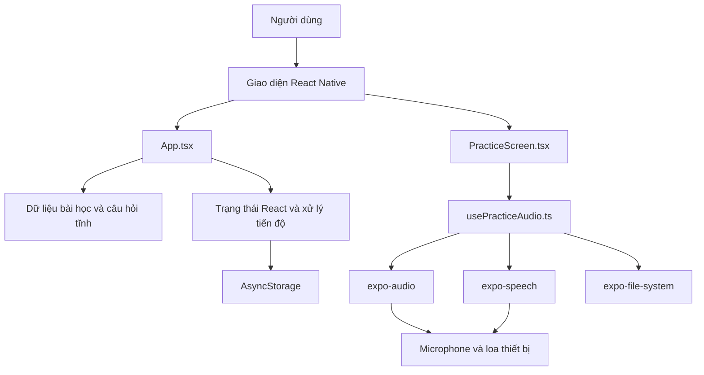

# Interview English — Kiến trúc dự án

## 1. Tổng quan

Interview English là ứng dụng di động được xây dựng bằng Expo và React Native,
hỗ trợ sinh viên ngành Công nghệ thông tin luyện trả lời phỏng vấn tiếng Anh cho
vị trí Software Intern.

## 2. Sơ đồ kiến trúc

## 3. Các thành phần chính

| Thành phần | Trách nhiệm |
|---|---|
| `App.tsx` | Hiển thị danh sách bài học, lưu tiến độ và điều hướng giữa các màn hình |
| `src/PracticeScreen.tsx` | Hiển thị câu hỏi, gợi ý, nút ghi âm và phát lại |
| `src/usePracticeAudio.ts` | Xử lý quyền microphone, ghi âm, phát lại và dọn file tạm |
| `AsyncStorage` | Lưu trạng thái luyện tập trên thiết bị |
| `expo-audio` | Ghi và phát âm thanh |
| `expo-speech` | Đọc câu hỏi và câu trả lời mẫu bằng giọng tổng hợp |
| `expo-file-system` | Quản lý file ghi âm tạm thời |
| `src/__tests__/PracticeAudio.test.tsx` | Kiểm thử logic ghi âm và phát âm thanh |

## 4. Luồng dữ liệu chính

1. Ứng dụng tải tiến độ đã lưu từ `AsyncStorage`.
2. người dùng chọn một bài học và câu hỏi phỏng vấn.
3. `App.tsx` truyền câu hỏi đã chọn sang `PracticeScreen.tsx`.
4. người dùng đọc hoặc nghe câu hỏi rồi ghi âm câu trả lời.
5. `usePracticeAudio.ts` điều khiển ghi âm và phát lại thông qua các API của Expo.
6. người dùng xem cụm từ và câu trả lời mẫu; `expo-speech` đọc nội dung nếu cần.
7. người dùng tự đánh dấu câu là `spoke` hoặc `review`.
8. tiến độ được lưu cục bộ bằng `AsyncStorage`.

## 5. Giới hạn hiện tại và hướng phát triển

MVP chưa có backend, đăng nhập, đồng bộ dữ liệu đám mây, chuyển giọng nói thành
văn bản hoặc đánh giá phát âm bằng AI. Bản ghi âm chỉ được lưu tạm thời trên thiết
bị và không được tải lên máy chủ.
