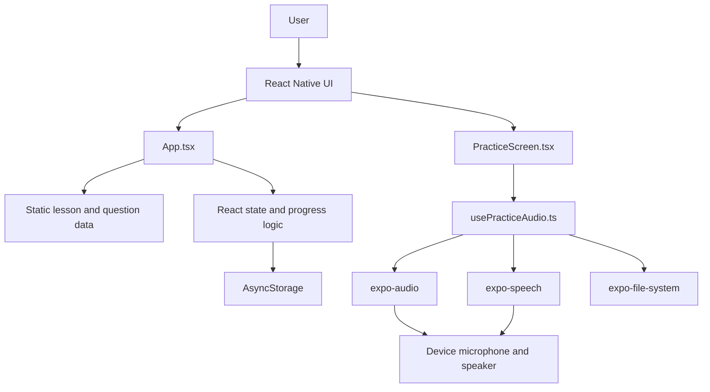

# Interview English — Project Architecture

## 1. Overview

Interview English is an Expo React Native mobile application that helps
Computer Science students practise English answers for Software Intern interviews.

The current MVP is a local-first mobile application. It does not use a backend,
login system, cloud database, speech-to-text service, or AI scoring service.

## 2. Architecture

## 3. Main components

| Component | Responsibility |
|---|---|
| `App.tsx` | Displays lessons, stores progress and controls navigation |
| `src/PracticeScreen.tsx` | Displays questions, hints, recording and playback controls |
| `src/usePracticeAudio.ts` | Handles microphone permission, recording, playback and cleanup |
| `AsyncStorage` | Saves the learner's local practice status |
| `expo-audio` | Records and plays audio |
| `expo-speech` | Reads questions and sample answers aloud |
| `expo-file-system` | Handles temporary recording files |
| `src/__tests__/PracticeAudio.test.tsx` | Tests the audio practice logic |

## 4. Main data flow

1. The app loads saved progress from `AsyncStorage`.
2. The learner selects a lesson and question.
3. `App.tsx` passes the selected question to `PracticeScreen.tsx`.
4. The learner reads or listens to the question and records an answer.
5. `usePracticeAudio.ts` manages recording and playback through Expo audio APIs.
6. The learner views phrases and a sample answer using `expo-speech`.
7. The learner marks the question as `spoke` or `review`.
8. The progress is saved locally with `AsyncStorage`.

## 5. Technology stack

- Expo and React Native
- TypeScript and React Hooks
- AsyncStorage
- expo-audio, expo-speech and expo-file-system
- Jest and React Native Testing Library

## 6. Current limitations and future work

The MVP has no backend, authentication, cloud synchronisation, speech-to-text,
or AI pronunciation evaluation. Recordings are temporary and are not uploaded.
Future versions may add user accounts, cloud progress, speech-to-text and AI
feedback after the core learning flow has been validated.
