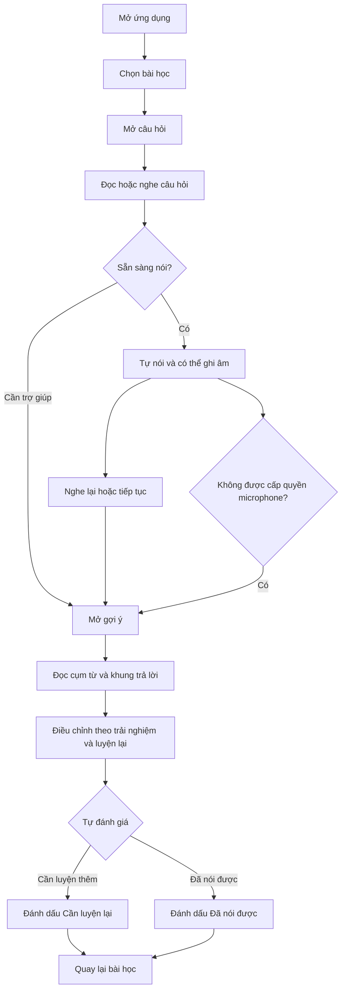
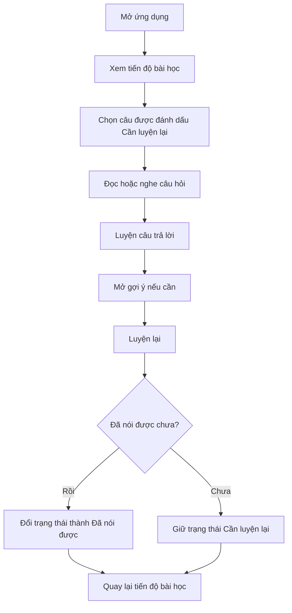

# Assignment 1 — Khám phá sản phẩm và nền tảng dự án

## Interview English — Luyện tiếng Anh phỏng vấn Software Intern

**Môn học:** CO3043 — Mobile Application Development  
**Cập nhật:** 14/10/2026  
**GitHub Organization:** https://github.com/mobile-app-CO3043  
**Repository:** https://github.com/mobile-app-CO3043/interview-english

> Phạm vi bằng chứng: Báo cáo sử dụng dữ liệu khảo sát hiện có và nêu rõ các giới hạn. Những kết luận chưa đủ bằng chứng được giữ ở trạng thái “cần kiểm tra thêm” hoặc “tạm giữ”, thay vì trình bày như đã được xác nhận.

---

## 1. Định hướng dự án

### Vấn đề

Sinh viên CNTT năm cuối hoặc mới tốt nghiệp đang chuẩn bị ứng tuyển vị trí **Software Intern** có thể biết kỹ năng, dự án và kinh nghiệm của mình, nhưng gặp khó khăn khi chuyển các ý đó thành câu trả lời tiếng Anh rõ ràng trong lúc luyện tập hoặc phỏng vấn.

Các cách chuẩn bị hiện tại thường là đọc bài viết/tài liệu, xem video, dùng công cụ AI hoặc tự viết câu trả lời. Những cách này có thể cung cấp nội dung, nhưng chưa chắc tạo ra một luồng luyện nói ngắn, có bối cảnh Software Intern, cho phép người học tự nói, xem gợi ý phù hợp với trải nghiệm của mình và luyện lại.

### Người dùng mục tiêu

Người dùng mục tiêu hiện tại là:

- Sinh viên năm cuối ngành CNTT hoặc ngành liên quan; hoặc mới tốt nghiệp trong vòng 12 tháng.
- Có kế hoạch ứng tuyển Software Intern trong ba tháng tới.
- Dự kiến sử dụng tiếng Anh trong phỏng vấn.
- Có một khoảng không gian riêng phù hợp để nói thành tiếng khi luyện tập.

### Bối cảnh và cách người dùng đang chuẩn bị

Người dùng chuẩn bị cho một cuộc phỏng vấn gần hạn, thường ở nhà hoặc trong phòng riêng. Họ có thể tìm tài liệu trên Internet, xem video, dùng AI hoặc tự viết câu trả lời. Khảo sát ban đầu cho thấy đọc bài viết/tài liệu là cách được chọn nhiều nhất trong nhóm phù hợp (6/9).

### Hướng giải pháp đề xuất

**Interview English** là ứng dụng hỗ trợ các phiên luyện ngắn 3–5 phút. Trong một lượt học, người dùng:

1. Chọn bài học hoặc câu hỏi phỏng vấn Software Intern.
2. Nghe/đọc câu hỏi và tự trả lời trước.
3. Xem cụm từ, khung trả lời và giải thích tiếng Việt.
4. Luyện lại dựa trên trải nghiệm thật của mình.
5. Tự đánh dấu câu đã nói được hoặc cần luyện thêm.

MVP không hứa hẹn AI chấm phát âm hay tự động đánh giá chất lượng nội dung.

### Thay đổi sau feedback

Chưa có thay đổi lớn về vấn đề cốt lõi. Tuy nhiên, bằng chứng hiện tại không ủng hộ mô tả rằng người dùng có thể luyện nói “mọi lúc, mọi nơi”. Hướng sản phẩm được thu hẹp thành luyện ngắn trong không gian riêng và cần được kiểm tra thêm về mức phù hợp của mobile.

---

## 2. Lý do chọn mobile

### Mobile có thể hỗ trợ việc luyện tập như thế nào?

- Một phiên luyện 3–5 phút có thể phù hợp với các tương tác ngắn trước khi phỏng vấn hoặc trong thời gian tự học.
- Điện thoại có micro và loa/tai nghe sẵn có để người học nghe câu hỏi, tự ghi âm và nghe lại.
- Tiến độ có thể được lưu cục bộ trên thiết bị, không cần người dùng mở máy tính chỉ để xem lại câu cần ôn.
- Thiết bị cá nhân giúp người dùng giữ bản ghi luyện tập ở trên máy thay vì chia sẻ cho người khác.

### Giới hạn và lựa chọn nền tảng khác

- Luyện nói thành tiếng cần không gian phù hợp; trong mẫu phù hợp, 4/9 người nói rằng họ phù hợp nhất khi ở nhà hoặc trong phòng riêng.
- 4/9 người nói rằng dù có nhu cầu luyện, họ ưu tiên máy tính hơn điện thoại.
- Máy tính có thể phù hợp hơn cho việc viết, đọc tài liệu dài hoặc chuẩn bị kỹ nội dung trước phỏng vấn.

### Quyết định hiện tại

**Cần kiểm tra thêm.** Mobile có thể hỗ trợ tốt lượt luyện ngắn có micro/ghi âm, nhưng khảo sát chưa đủ để kết luận điện thoại tốt hơn máy tính cho toàn bộ việc chuẩn bị phỏng vấn. Nhóm sẽ kiểm tra điều này qua task test trên điện thoại trước khi coi lựa chọn này là phù hợp.

Mobile không được chọn chỉ vì đây là môn Mobile Application Development.

---

## 3. Các giả định quan trọng

| ID | Giả định | Vì sao quan trọng | Trạng thái hiện tại |
|---|---|---|---|
| A1 | Người dùng mục tiêu gặp khó khăn khi diễn đạt tiếng Anh và có nhu cầu luyện lại. | Nếu vấn đề ít xảy ra hoặc không được ưu tiên, sản phẩm sẽ không có nhu cầu rõ ràng. | Cần kiểm tra thêm |
| A2 | Luồng tự nói → xem gợi ý → luyện lại có giá trị hơn chỉ đọc nội dung. | Đây là luồng giá trị cốt lõi của MVP. | Tạm giữ |
| A3 | Một phiên luyện nói 3–5 phút trên điện thoại phù hợp với hoàn cảnh thực tế. | Giả định này ảnh hưởng đến việc chọn mobile làm nền tảng. | Cần kiểm tra thêm / Điều chỉnh |
| A4 | Gợi ý theo ngữ cảnh Software Intern và giải thích tiếng Việt giúp người dùng tự điều chỉnh câu trả lời. | Giả định này quyết định phạm vi nội dung và cách trình bày gợi ý. | Tạm giữ |
| A5 | Tự đánh dấu “Đã nói được/Cần luyện lại” đủ hữu ích ở MVP đầu tiên. | Nếu không, phần theo dõi tiến độ cần được thay đổi hoặc thu hẹp. | Cần kiểm tra thêm |

### Giả định được ưu tiên kiểm tra

**A1:** Sinh viên CNTT thuộc target user thực sự thường gặp khó khăn khi biến ý kỹ thuật hoặc trải nghiệm dự án thành câu trả lời tiếng Anh trong lúc chuẩn bị/phỏng vấn Software Intern; các cách chuẩn bị hiện tại chưa đáp ứng đầy đủ nhu cầu luyện nói theo bối cảnh này.

---

## 4. Kế hoạch thu thập bằng chứng

### Những điều cần tìm hiểu

- Vấn đề có xảy ra trong hành vi gần đây hay chỉ là cảm nhận chung?
- Người dùng hiện chuẩn bị bằng cách nào và thiếu điều gì?
- Người dùng có thể hoàn thành luồng tự nói → gợi ý → luyện lại không?
- Họ thực sự sẽ dùng điện thoại hay máy tính, trong bối cảnh nào?

### Câu hỏi nghiên cứu

Với sinh viên CNTT sắp ứng tuyển Software Intern bằng tiếng Anh, việc luyện nói theo câu hỏi có ngữ cảnh và gợi ý cụm từ có giải quyết một khoảng trống thực tế so với cách chuẩn bị hiện tại không; và điện thoại có phù hợp cho lượt luyện 3–5 phút không?

### Bằng chứng đã thu thập

- Khảo sát trực tuyến gồm 23 phản hồi từ 05/10/2026 đến 12/10/2026.
- Sau sàng lọc theo target user hẹp, mẫu phân tích là 9 phản hồi.

### Những điểm vẫn chưa chắc chắn

Khảo sát chỉ đo tự báo cáo và ý định dùng. Nó không chứng minh người dùng thao tác được trên sản phẩm thật, sử dụng lặp lại hay cải thiện khả năng phỏng vấn.

### Phương pháp tiếp theo: task test có quan sát và phỏng vấn ngắn

| Hạng mục | Kế hoạch |
|---|---|
| Phương pháp | 5–6 buổi task test có quan sát, kết hợp phỏng vấn ngắn 15–20 phút. |
| Người tham gia | Người đạt đủ ba điều kiện sàng lọc của nhóm mục tiêu; không dùng người đã bị loại ở bước sàng lọc. |
| Nhiệm vụ | Chọn một câu hỏi, tự nói câu trả lời, mở gợi ý, tự điều chỉnh câu trả lời, luyện lại và đánh dấu cần ôn. |
| Bằng chứng ủng hộ A1/A2 | Người tham gia kể được một tình huống gần đây, hoàn thành luồng mà không cần giải thích nhiều và thấy luồng này giải quyết khó khăn thực tế hơn cách hiện tại. |
| Bằng chứng phản bác A1/A2 | Họ ít khi cần luyện, chỉ cần đọc tài liệu hoặc không thấy gợi ý/luyện lại tạo thêm giá trị. |
| Bằng chứng ủng hộ mobile | Người tham gia chọn và dùng điện thoại trong một bối cảnh thực tế phù hợp. |
| Bằng chứng phản bác mobile | Họ nhất quán ưu tiên máy tính hoặc không có nơi phù hợp để nói trên điện thoại. |
| Kết quả chưa thể kết luận | Phản hồi chia đều, không có bối cảnh sử dụng rõ hoặc không thể hoàn thành nhiệm vụ vì prototype chưa đủ. |

---

## 5. Nghiên cứu người dùng

### Phương pháp và cách chọn người tham gia

Nhóm sử dụng Google Forms để thu thập phản hồi. File xuất có 23 dòng phản hồi, tất cả có dấu thời gian. Form không thu dữ liệu định danh.

Target user được xác định bằng ba điều kiện: sinh viên năm cuối CNTT/ngành liên quan hoặc mới tốt nghiệp trong 12 tháng; có kế hoạch ứng tuyển Software Intern trong ba tháng; và dự kiến dùng tiếng Anh khi phỏng vấn. File hiện không có người mới tốt nghiệp phù hợp; 9 sinh viên năm cuối thỏa cả ba điều kiện được dùng làm mẫu phân tích.

### Giới hạn của bằng chứng tuyển người và nghiên cứu

File xuất khảo sát không ghi nhận kênh tuyển người tham gia hoặc tiêu chí chọn người
ngoài các câu hỏi sàng lọc. Vì vậy, dữ liệu hiện tại được xem là mẫu nghiên cứu khám
phá, không phải mẫu đại diện có thể dùng để suy rộng cho toàn bộ sinh viên CNTT.

Báo cáo này không tuyên bố đã có bằng chứng từ task test có điều phối hoặc phỏng vấn
sâu. Các phát hiện hiện dựa trên hành vi tự báo cáo và ý định của người trả lời,
chưa phải hành vi quan sát khi dùng prototype. Do đó, các assumption về việc sử dụng
lặp lại, mức phù hợp của mobile và giá trị của speaking loop vẫn được giữ ở trạng
thái “cần kiểm tra thêm” hoặc “tạm giữ”, thay vì được trình bày như đã
được xác nhận.

### Chất lượng và cách xử lý dữ liệu

- 23/23 phản hồi có dữ liệu ở câu 1–10; câu hỏi mở cuối có 17/23 phản hồi trống.
- Không có hai bộ câu trả lời hoàn toàn giống nhau, nhưng do không thu định danh, không thể khẳng định tuyệt đối mỗi dòng là một người khác nhau.
- Nhóm gộp hai cách ghi tương đương ở câu ngành học: “CNTT” và “công nghệ thông tin”.
- Người không đạt sàng lọc vẫn có câu trả lời ở các câu chính. Điều này cho thấy phân nhánh form có thể chưa được cấu hình hoặc chưa hoạt động đúng. Các số liệu chính vì vậy chỉ dùng mẫu `n = 9`.

### Kết quả từ nhóm người dùng mục tiêu (n = 9)

| Phát hiện | Bằng chứng | Diễn giải |
|---|---|---|
| Vấn đề chưa được chứng minh là thường xuyên | 5/9 chưa luyện/phỏng vấn tiếng Anh trong 30 ngày; 2/9 đã luyện nhưng không gặp khó khăn; 2/9 báo cáo 1–5 buổi biết ý nhưng khó diễn đạt. | Không thể khẳng định A1 đã được xác nhận. |
| Cách chuẩn bị hiện tại thiên về đọc | 6/9 chọn đọc bài viết/tài liệu Internet là cách dùng nhiều nhất. | Có cơ hội kiểm tra liệu việc chuyển từ đọc sang nói có tạo giá trị hay không. |
| Thiếu phản hồi và ngữ cảnh là các tín hiệu nhu cầu | 3/9 không biết câu trả lời cần cải thiện ở đâu; 2/9 nói nội dung ít liên quan Software Intern. | Gợi ý theo bối cảnh có thể hữu ích, nhưng cần task test. |
| Core learning loop có tín hiệu ban đầu | 5/9 chọn tự nói → gợi ý → luyện lại là giá trị nhất; 3/9 chọn cụm từ/khung trả lời. | Giữ hai phần này trong MVP một cách tạm thời. |
| Mobile context bị chia đôi | 4/9 chọn ở nhà/phòng riêng; 4/9 ưu tiên máy tính hơn điện thoại. | Không được quảng bá là “luyện mọi lúc, mọi nơi”. |
| Luồng chưa hoàn toàn tự giải thích | 5/9 hiểu luồng; 2/9 chưa rõ bước tự nói trước gợi ý; 2/9 chưa rõ cách cá nhân hóa gợi ý. | Cần hướng dẫn ngắn trong lượt học đầu tiên. |

### Giới hạn của nghiên cứu

- Mẫu nhỏ, không được chọn ngẫu nhiên và chưa đại diện cho toàn bộ sinh viên CNTT.
- Nhiều người trả lời không thuộc target user hẹp.
- Phản hồi về tính năng và mobile là ý định sau khi đọc mô tả, không phải hành vi quan sát trên app.
- Không có phỏng vấn sâu, quan sát ngữ cảnh hoặc đo lường kết quả học.

---

## 6. Giải pháp hiện có và các lựa chọn thay thế

| Lựa chọn hiện có | Đang giải quyết điều gì | Nhóm rút ra điều gì | Cơ hội và giới hạn của Interview English |
|---|---|---|---|
| [ELSA Speak](https://elsaspeak.com/en) | Luyện nói tiếng Anh, role-play và phản hồi phát âm/cá nhân hóa bằng AI. | Phản hồi nhanh và bài học ngắn là giá trị người học đã có thể kỳ vọng. | MVP không cạnh tranh bằng chấm phát âm AI; tập trung vào câu hỏi Software Intern, gợi ý song ngữ và luồng đơn giản. Cần kiểm tra trực tiếp mức độ bao phủ nội dung phỏng vấn kỹ thuật của ELSA trước khi tuyên bố khác biệt. |
| [Speak](https://www.speak.com/) | Luyện hội thoại AI, phản hồi cách phát âm/cách diễn đạt và bài học theo trình độ. | Hội thoại AI là một phương án thay thế mạnh cho luyện nói tổng quát. | Lợi thế tiềm năng chỉ là phạm vi hẹp: người học Software Intern có thể bắt đầu ngay với câu hỏi đã chọn, không cần tạo kịch bản. Đây là giả định cần kiểm tra. |
| [ChatGPT Voice](https://help.openai.com/en/articles/20001274/) | Hội thoại giọng nói tự do, có thể nói, nghe phản hồi, chuyển sang text và xem lại chat. | Người học có thể tự tạo buổi luyện bằng prompt. | Interview English cần giảm công sức tự thiết kế prompt/câu hỏi và đưa cấu trúc câu trả lời dễ dùng hơn; không nên khẳng định ChatGPT thiếu khả năng luyện phỏng vấn. |
| [Big Interview](https://support.biginterview.com/en/article/the-big-interview-mobile-app-j6ca3/) | Câu hỏi phỏng vấn, ghi câu trả lời trên điện thoại, bài học và theo dõi; một số tổ chức có VideoAI feedback. | Có những đối thủ dành riêng cho interview practice và đã hỗ trợ ghi âm/ghi hình. | MVP nên nhỏ hơn: một số tình huống Software Intern phổ biến, không thêm chấm điểm/video AI hoặc quản lý hồ sơ. |
| Đọc tài liệu/video và tự ghi âm | 6/9 target users chọn đọc tài liệu Internet là cách chuẩn bị chính; một số tự viết/tự nói. | Đây là lựa chọn thay thế thực tế nhất của người khảo sát. | App phải chứng minh rằng nó giúp chuyển việc đọc thành một lượt nói/luyện lại rõ ràng; nếu không, nội dung chỉ là một nguồn tài liệu khác. |

### Quyết định sản phẩm sau khi so sánh

Nhóm không cố thay thế công cụ AI phản hồi toàn diện hay dịch vụ mock interview. Giá trị khác biệt cần được kiểm chứng là: **một lượt luyện nhỏ, có câu hỏi Software Intern, gợi ý song ngữ và yêu cầu người học cá nhân hóa câu trả lời dựa trên trải nghiệm thật.**

---

## 7. Đánh giá bằng chứng và quyết định sản phẩm

| Giả định | Bằng chứng | Quyết định | Thay đổi đối với dự án |
|---|---|---|---|
| A1: Vấn đề xảy ra thường xuyên | Chỉ 2/9 báo cáo tình huống biết ý nhưng khó diễn đạt trong 30 ngày gần đây. | Cần kiểm tra thêm | Phỏng vấn/task test về hành vi gần đây; không ghi đây là vấn đề phổ biến đã được xác nhận. |
| A2: Luồng tự nói → gợi ý → luyện lại có giá trị | 5/9 chọn luồng này; 3/9 chọn cụm từ/khung trả lời. | Tạm giữ | Giữ luồng luyện tập cốt lõi trong MVP. |
| A3: Mobile phù hợp | 4/9 ưu tiên máy tính; 4/9 phù hợp luyện ở nhà/phòng riêng. | Cần kiểm tra thêm / Điều chỉnh | Định vị mobile cho không gian riêng; kiểm tra trên prototype, không hứa “mọi nơi”. |
| A4: Người dùng hiểu luồng | 4/9 chưa rõ ít nhất một bước. | Điều chỉnh | Thêm hướng dẫn ngắn và ví dụ về cách tự điều chỉnh gợi ý. |
| A5: Tự đánh giá là đủ | Khảo sát chưa đo được liệu người dùng có tự đánh giá nhất quán hay không. | Cần kiểm tra thêm | Giữ nút tự đánh dấu đơn giản, không diễn giải nó như điểm năng lực. |

---

## 8. Business Canvas 3×3 theo yêu cầu môn học

| Vấn đề | Giải pháp | Giá trị |
|---|---|---|
| Người học có thể biết ý nhưng khó biến thành câu trả lời tiếng Anh theo bối cảnh Software Intern; cách chuẩn bị thiên về đọc. | Bài học ngắn theo câu hỏi phỏng vấn; tự nói, gợi ý song ngữ, luyện lại, tự đánh dấu cần ôn. | Giảm công sức tìm/sắp xếp tài liệu và tạo một bước chuyển từ đọc sang thực hành nói. |
| Khách hàng / Người dùng | Lợi thế | Chỉ số theo dõi |
| Sinh viên CNTT năm cuối hoặc mới tốt nghiệp, sắp ứng tuyển Software Intern bằng tiếng Anh. | Phạm vi hẹp, nội dung theo tình huống Software Intern và gợi ý có thể cá nhân hóa; không cố thay thế AI coach toàn diện. | Hoàn thành lượt luyện; số câu được luyện lại; tỷ lệ người hoàn thành task không cần trợ giúp; phản hồi sau task test. |
| Kênh tiếp cận | Chi phí | Doanh thu |
| [Giả định] Chia sẻ qua lớp học, cộng đồng sinh viên CNTT, career fair và bạn bè chuẩn bị ứng tuyển. | Thời gian viết/kiểm duyệt nội dung; thiết kế/triển khai app; kiểm thử trên thiết bị. MVP không dùng API AI trả phí. | [Giả định] Không đặt mục tiêu doanh thu trong phạm vi môn học. Các hướng tương lai có thể là gói nội dung hoặc hợp tác trung tâm đào tạo, nhưng chưa được kiểm chứng. |

---

## 9. Phạm vi và ưu tiên của MVP

### Mục tiêu chính của người dùng

Luyện và diễn đạt được một câu trả lời ngắn bằng tiếng Anh cho câu hỏi Software Intern dựa trên trải nghiệm thật của bản thân.

### Luồng giá trị cốt lõi

Chọn bài học → đọc/nghe câu hỏi → tự nói/ghi âm → xem gợi ý → luyện lại → đánh dấu cần ôn hoặc đã nói được.

### Ma trận tác động và công sức

| Tính năng | Tác động dự kiến | Công sức | Quyết định MVP | Lý do |
|---|---|---|---|---|
| Câu hỏi theo ba chủ đề Software Intern | Cao | Thấp | Đưa vào | Cần để tạo ngữ cảnh khác với tài liệu tiếng Anh tổng quát. |
| Tự nói và ghi/nghe lại bản thu | Cao | Trung bình | Đưa vào | Hỗ trợ chuyển từ đọc sang luyện nói. |
| Cụm từ, khung trả lời và giải thích tiếng Việt | Cao | Trung bình | Đưa vào | Có tín hiệu nhu cầu về nội dung theo ngữ cảnh. |
| Luyện lại và tự đánh dấu cần ôn | Trung bình | Thấp | Đưa vào | Giúp người dùng biết câu cần quay lại; cần kiểm tra giá trị sau này. |
| Hướng dẫn lượt học đầu tiên | Trung bình | Thấp | Đưa vào | 4/9 chưa rõ một bước trong luồng mô tả. |
| AI chấm phát âm/nội dung | Cao nhưng chưa chắc chắn | Cao | Chưa đưa vào | Không đủ bằng chứng và vượt quá khả năng MVP. |
| Chatbot phỏng vấn động | Trung bình | Cao | Chưa đưa vào | Không cần để người dùng nhận giá trị cốt lõi. |
| Đăng nhập, đồng bộ đám mây, lịch sử bản thu dài hạn | Thấp | Cao | Chưa đưa vào | Không bắt buộc cho vòng luyện đầu tiên. |
| Nội dung cho nhiều job role khác | Trung bình | Cao | Chưa đưa vào | Tăng phạm vi nội dung trước khi xác nhận nhu cầu Software Intern. |

### Rủi ro chính

- Người dùng mục tiêu có thể không luyện nói đủ thường xuyên để quay lại app.
- Mobile có thể không phải nền tảng ưa thích của một phần người dùng.
- Mẫu câu cố định có thể không đủ giúp người dùng cá nhân hóa câu trả lời.
- Người dùng có thể ngại nói thành tiếng khi không có không gian riêng.

---

## 10. Các user story

| Mã | Nhu cầu người dùng | Tính năng MVP liên quan |
|---|---|---|
| US-01 | Là sinh viên chuẩn bị phỏng vấn Software Intern, tôi muốn chọn chủ đề như giới thiệu bản thân hoặc kinh nghiệm dự án để luyện đúng dạng câu hỏi mình cần. | Chọn bài học |
| US-02 | Là người học, tôi muốn đọc hoặc nghe câu hỏi trước khi trả lời để hiểu mình cần nói về điều gì. | Hiển thị và đọc câu hỏi |
| US-03 | Là người học, tôi muốn tự nói và có thể nghe lại bản ghi trước khi xem gợi ý để biết mình đã diễn đạt được gì. | Ghi âm và phát lại |
| US-04 | Là người học, tôi muốn xem cụm từ tiếng Anh và khung trả lời có giải thích tiếng Việt để điều chỉnh theo kinh nghiệm dự án của mình. | Gợi ý theo ngữ cảnh |
| US-05 | Là người học, tôi muốn đánh dấu câu cần luyện thêm hoặc đã nói được để tập trung vào những câu cần ôn trong lần sau. | Theo dõi tiến độ cục bộ |
| US-06 | Là người mới sử dụng, tôi muốn có hướng dẫn ngắn về các bước luyện tập để biết cần làm gì trước khi bắt đầu nói. | Hướng dẫn lần đầu |

### Liên kết từ bằng chứng đến tính năng

| Bằng chứng / giả định | Nhu cầu người dùng | Yêu cầu | User story | Tính năng MVP | Luồng người dùng | Công việc phát triển |
|---|---|---|---|---|---|---|
| 6/9 hiện đang dùng tài liệu đọc; giả định rằng luyện nói sẽ tạo thêm giá trị | Chuyển từ đọc sang thực hành | Yêu cầu người học tự trả lời trước khi xem gợi ý rồi luyện lại | US-03, US-04 | Luồng luyện tập cốt lõi | Luồng 1 — Luyện một câu hỏi phỏng vấn | Xử lý câu hỏi, ghi âm và trạng thái gợi ý |
| 3/9 không biết cần cải thiện điểm nào; 2/9 nhắc đến mức độ liên quan của nội dung | Có hỗ trợ theo ngữ cảnh khi trả lời | Hiển thị cụm từ theo vai trò và khung trả lời có thể điều chỉnh | US-01, US-04 | Bài học và gợi ý | Luồng 1 — Luyện một câu hỏi phỏng vấn | Xây dựng danh sách bài học và dữ liệu gợi ý |
| 4/9 chưa hiểu đầy đủ luồng được mô tả | Dễ bắt đầu ngay lần đầu | Giải thích các bước bằng một ví dụ ngắn | US-06 | Hướng dẫn lần đầu | Luồng 1 — Luyện một câu hỏi phỏng vấn | Xây dựng hướng dẫn lần đầu |
| Giả định rằng người học sẽ quay lại các câu khó | Tìm lại câu cần ôn | Lưu trạng thái tự đánh giá ở thiết bị | US-05 | Theo dõi tiến độ | Luồng 2 — Ôn lại câu cần luyện thêm | Lưu trạng thái luyện tập cục bộ |

---

## 11. Luồng người dùng quan trọng

### Luồng 1 — Luyện một câu hỏi phỏng vấn

**Kết quả mong đợi:** Người học hoàn thành một câu hỏi và tự đánh dấu trạng thái luyện tập. Nếu không được cấp quyền microphone, người học vẫn có thể đọc/nghe câu hỏi và xem gợi ý.

### Luồng 2 — Ôn lại câu cần luyện thêm

**Kết quả mong đợi:** Người học tìm được câu khó và cập nhật trạng thái sau một lần luyện tiếp theo.

---

## 12. Nền tảng và kế hoạch dự án

### Thiết lập GitHub

- GitHub Organization: https://github.com/mobile-app-CO3043
- Repository: https://github.com/mobile-app-CO3043/interview-english
- Public project board và quyền truy cập thành viên: Đang hoàn tất thiết lập.

Organization và repository là không gian làm việc của dự án. Link GitHub Project và trạng thái thành viên sẽ được kiểm tra trong public submission entry point trước khi nộp chính thức.

### Quy trình GitHub Project dự kiến

`Backlog → To Do → In Progress → Review → Done`

| Mốc | Công việc | Người phụ trách | Trạng thái |
|---|---|---|---|
| Assignment 1 | Cấu hình screening của Google Form và ghi lại cách tuyển người | Chưa phân công | Backlog |
| Assignment 1 | Thực hiện 5–6 task test/phỏng vấn | Chưa phân công | Backlog |
| Assignment 1 | Phân tích nghiên cứu và cập nhật quyết định | Chưa phân công | Backlog |
| Assignment 1 | Tìm hiểu và ghi lại năm giải pháp thay thế | Chưa phân công | To Do |
| Assignment 1 | Hoàn thiện tài liệu Wiki | Chưa phân công | Backlog |
| Assignment 2 | Tạo flow Figma dựa trên US-01 đến US-06 | Chưa phân công | Backlog |
| Triển khai | Xây dựng các tính năng bài học, luyện tập và tiến độ | Chưa phân công | Backlog |
| Triển khai | Kiểm thử quyền âm thanh và trường hợp ghi âm không thành công | Chưa phân công | Backlog |

> Đây là kế hoạch dự kiến. Owner sẽ được gán trong GitHub Project sau khi nhóm thống nhất phân công; các task này chưa được trình bày như đã hoàn thành.

---

## 13. Checklist trước khi nộp

- [ ] Có public submission entry point và link đã được kiểm tra quyền truy cập.
- [ ] Các thành viên chính thức đã tham gia GitHub Organization.
- [ ] GitHub Project đã có task thực tế, người phụ trách, trạng thái và mốc thời gian.
- [ ] Wiki có trang điều hướng rõ ràng tới các phần của dự án.
- [ ] Kênh tuyển người và tiêu chí chọn người tham gia đã được ghi lại.
- [ ] Phân nhánh/sàng lọc được sửa trước khi thu thêm phản hồi.
- [ ] Đã thực hiện và tóm tắt ít nhất 5–6 task test hoặc phỏng vấn với người dùng mục tiêu.
- [ ] Các link tới bằng chứng nghiên cứu và giải pháp thay thế vẫn truy cập được.
- [ ] Các link research evidence đã được kiểm tra quyền truy cập.
- [ ] Public project entry point liên kết tới Wiki, Organization và Project.

---

## Nguồn tham khảo

- File xuất khảo sát nội bộ: [Phản hồi khảo sát](./Khảo%20sát%20nhu%20cầu%20luyện%20phỏng%20vấn%20Software%20Intern%20bằng%20tiếng%20Anh%20(Câu%20trả%20lời).xlsx), thu thập từ 05/10/2026 đến 12/10/2026.
- [ELSA Speak — trang sản phẩm](https://elsaspeak.com/en)
- [Speak — trang sản phẩm](https://www.speak.com/)
- [ChatGPT Voice — Trung tâm trợ giúp OpenAI](https://help.openai.com/en/articles/20001274/)
- [Ứng dụng di động Big Interview — Trung tâm trợ giúp](https://support.biginterview.com/en/article/the-big-interview-mobile-app-j6ca3/)
